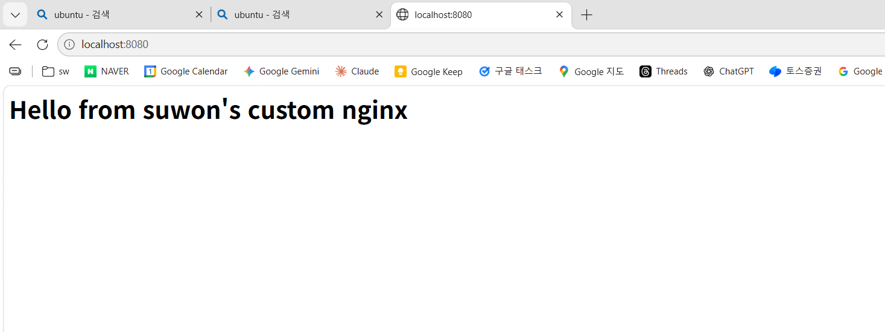
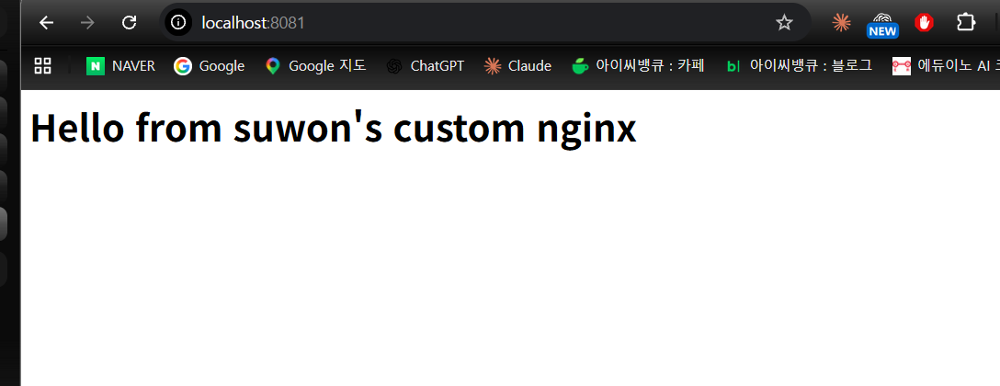
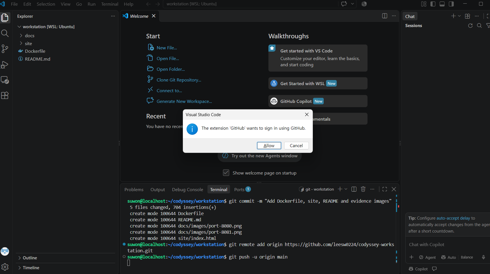

# 개발 워크스테이션 구축 (터미널 · Docker · Git)

> 진행 상황: 터미널, 권한, Docker 전 과정(설치·운영·커스텀 이미지·포트·바인드 마운트·볼륨), Git 설정 완료.
> `TODO` 표시: VSCode GitHub 연동 증거(스크린샷)와 최종 보안 점검.

---

## 1. 프로젝트 개요

터미널, Docker, Git/GitHub를 직접 세팅하고, 컨테이너 실행·포트 매핑·바인드 마운트·볼륨 영속성을 검증하여 누구나 같은 방식으로 실행할 수 있는 재현 가능한 개발 환경을 구성한다.

## 2. 실행 환경

| 항목 | 버전 / 내용 |
|---|---|
| Host OS | Windows |
| Linux 환경 | WSL2 + Ubuntu 26.04.1 LTS (Resolute Raccoon) |
| Kernel | 6.18.54.1-microsoft-standard-WSL2 |
| Shell | bash |
| Terminal | Windows Terminal (Ubuntu), VSCode 통합 터미널 |
| Docker 실행 환경 | Docker Desktop 4.97.0 (WSL 2 백엔드, WSL integration: Ubuntu) |
| Docker Engine | 29.9.2 (build a82e528) |
| Git | 2.53.0 |
| Editor | Visual Studio Code 1.143.1 + WSL 확장 |

## 3. 저장소 구조

```text
.
├── README.md
├── Dockerfile
├── site/
│   └── index.html
└── docs/
    └── images/        # 브라우저·VSCode 스크린샷 증거
```

## 4. 수행 체크리스트

- [x] 터미널 기본 조작 (위치 확인, 목록, 이동, 생성, 복사, 이동/이름변경, 삭제, 내용 확인, 빈 파일)
- [x] 권한 변경 실습 (파일 1개, 디렉터리 1개, 변경 전/후 비교)
- [x] Docker 설치 및 점검 (`docker --version`, `docker info`)
- [x] Docker 기본 운영 명령 (images, ps, ps -a, logs, stats)
- [x] hello-world 실행
- [x] ubuntu 컨테이너 진입 및 명령 수행, attach/exec 차이 관찰
- [x] Dockerfile 커스텀 이미지 빌드/실행
- [x] 포트 매핑 접속 (2회: 8080, 8081)
- [x] 바인드 마운트 변경 반영
- [x] Docker 볼륨 영속성 (컨테이너 삭제 전/후)
- [x] Git 사용자 정보·기본 브랜치 설정
- [ ] VSCode GitHub 로그인 및 저장소 연동 (TODO: 스크린샷)
- [ ] 민감정보 마스킹 최종 확인

---

## 5. 터미널 조작 로그

> 작업 위치: WSL Ubuntu의 리눅스 홈(`/home/suwon`) 아래 `~/codyssey/practice`
> Windows 드라이브 경로(`/mnt/c/...`)가 아닌 리눅스 홈에서 작업해야 권한(chmod)이 정상 반영된다.

### 5-1. 현재 위치 확인 및 작업 폴더 생성·이동

```bash
$ cd ~
$ pwd
/home/suwon

$ mkdir -p ~/codyssey/practice
$ cd ~/codyssey/practice
$ pwd
/home/suwon/codyssey/practice

$ ls -la
total 8
drwxr-xr-x 2 suwon suwon 4096 Nov  2 20:43 .
drwxr-xr-x 3 suwon suwon 4096 Nov  2 20:43 ..
```

### 5-2. 빈 파일 생성, 내용 작성·확인, 복사

```bash
$ touch empty.txt
$ echo "hello codyssey" > memo.txt
$ cat memo.txt
hello codyssey

$ cp memo.txt memo_copy.txt
$ ls -la
total 16
drwxr-xr-x 2 suwon suwon 4096 Nov  2 20:52 .
drwxr-xr-x 3 suwon suwon 4096 Nov  2 20:43 ..
-rw-r--r-- 1 suwon suwon    0 Nov  2 20:51 empty.txt
-rw-r--r-- 1 suwon suwon   15 Nov  2 20:51 memo.txt
-rw-r--r-- 1 suwon suwon   15 Nov  2 20:52 memo_copy.txt
```

- `empty.txt`의 크기 0 → 빈 파일 생성 확인
- `memo.txt`의 크기 15 → `hello codyssey`(14자) + `echo`가 붙이는 줄바꿈 1바이트

### 5-3. 이름 변경, 디렉터리로 이동, 삭제

```bash
$ mv memo_copy.txt memo_renamed.txt
$ mkdir sub
$ mv memo_renamed.txt sub/

$ ls -la
total 16
drwxr-xr-x 3 suwon suwon 4096 Nov  2 20:53 .
drwxr-xr-x 3 suwon suwon 4096 Nov  2 20:43 ..
-rw-r--r-- 1 suwon suwon    0 Nov  2 20:51 empty.txt
-rw-r--r-- 1 suwon suwon   15 Nov  2 20:51 memo.txt
drwxr-xr-x 2 suwon suwon 4096 Nov  2 20:53 sub

$ ls -la sub
total 12
drwxr-xr-x 2 suwon suwon 4096 Nov  2 20:53 .
drwxr-xr-x 3 suwon suwon 4096 Nov  2 20:53 ..
-rw-r--r-- 1 suwon suwon   15 Nov  2 20:52 memo_renamed.txt

$ rm sub/memo_renamed.txt
$ ls -la sub
total 8
drwxr-xr-x 2 suwon suwon 4096 Nov  2 20:53 .
drwxr-xr-x 3 suwon suwon 4096 Nov  2 20:53 ..
```

- `mv`는 같은 위치에서 쓰면 **이름 변경**, 다른 디렉터리를 지정하면 **이동**이 된다.
- `rm`으로 삭제한 파일은 휴지통을 거치지 않고 바로 삭제된다.

## 6. 권한 실습

### 6-1. 파일 권한 (memo.txt)

```bash
$ ls -l memo.txt
-rw-r--r-- 1 suwon suwon 15 Nov  2 20:51 memo.txt

$ chmod 600 memo.txt
$ ls -l memo.txt
-rw------- 1 suwon suwon 15 Nov  2 20:51 memo.txt

$ chmod 644 memo.txt
$ ls -l memo.txt
-rw-r--r-- 1 suwon suwon 15 Nov  2 20:51 memo.txt
```

| 단계 | 숫자 | 기호 | 의미 |
|---|---|---|---|
| 변경 전 | 644 | `rw-r--r--` | 소유자 읽기·쓰기, 그룹·기타 읽기 |
| 변경 후 | 600 | `rw-------` | 소유자만 읽기·쓰기, 그룹·기타 권한 없음 |
| 복구 | 644 | `rw-r--r--` | 원래 상태 |

### 6-2. 디렉터리 권한 (sub)

```bash
$ ls -ld sub
drwxr-xr-x 2 suwon suwon 4096 Nov  2 20:53 sub

$ chmod 644 sub
$ ls -ld sub
drw-r--r-- 2 suwon suwon 4096 Nov  2 20:53 sub

$ cd sub
bash: cd: sub: Permission denied

$ chmod 755 sub
$ ls -ld sub
drwxr-xr-x 2 suwon suwon 4096 Nov  2 20:53 sub

$ cd sub
$ pwd
/home/suwon/codyssey/practice/sub
$ cd ..
```

| 단계 | 숫자 | 기호 | 결과 |
|---|---|---|---|
| 변경 전 | 755 | `rwxr-xr-x` | 진입 가능 |
| 변경 후 | 644 | `rw-r--r--` | `cd sub` → Permission denied |
| 복구 | 755 | `rwxr-xr-x` | 다시 진입 가능 |

### 6-3. 권한 표기 해석

- r = 4, w = 2, x = 1 을 더한 값이며, 세 자리는 **소유자 / 그룹 / 기타 사용자** 순서이다.
- `755` = `rwxr-xr-x` : 소유자는 읽기·쓰기·실행, 그룹과 기타는 읽기·실행
- `644` = `rw-r--r--` : 소유자는 읽기·쓰기, 그룹과 기타는 읽기만
- `ls -l` 맨 앞 글자는 종류를 뜻한다. `-`는 일반 파일, `d`는 디렉터리.
- 디렉터리에서 `x`는 그 디렉터리 안으로 **들어갈(cd) 수 있는 권한**이다. 6-2에서 `x`만 빠진 644로 바꾸자 소유자 본인도 진입할 수 없었고, 755로 되돌리자 다시 진입할 수 있었다.

## 7. Docker 설치 및 기본 점검

- 설치: Docker Desktop 4.97.0 (Per-user installation, WSL 2 백엔드)
- 설정: Settings → WSL integration → "Enable integration with my default WSL distro" 및 Ubuntu 활성화 → Apply & Restart Engine

```bash
$ docker --version
Docker version 29.9.2, build a82e528
```

```bash
$ docker info
Client:
 Version:    29.9.2
 Context:    default
 Debug Mode: false
 ...(플러그인 목록 생략)

Server:
 Containers: 0
  Running: 0
  Paused: 0
  Stopped: 0
 Images: 0
 Server Version: 29.9.2
 Storage Driver: overlayfs
 Cgroup Driver: cgroupfs
 Cgroup Version: 2
 Kernel Version: 6.18.54.1-microsoft-standard-WSL2
 Operating System: Docker Desktop
 OSType: linux
 Architecture: x86_64
 CPUs: 12
 Total Memory: 7.602GiB
 ...(이하 생략)
```

- **Server:** 항목이 출력되므로 CLI가 Docker 데몬에 정상 연결된 상태이다.
- `Containers: 0`, `Images: 0` → 아직 아무 컨테이너·이미지도 없는 초기 상태

## 8. Docker 기본 운영 명령

### 8-1. 이미지·컨테이너 목록 (hello-world 실행 직후)

```bash
$ docker images
IMAGE                ID             DISK USAGE   CONTENT SIZE   EXTRA
hello-world:latest   c567b231f656       25.9kB         9.49kB    U

$ docker ps
CONTAINER ID   IMAGE     COMMAND   CREATED   STATUS    PORTS     NAMES

$ docker ps -a
CONTAINER ID   IMAGE         COMMAND    CREATED              STATUS                          PORTS     NAMES
4a1ba52bcbae   hello-world   "/hello"   About a minute ago   Exited (0) About a minute ago             hardcore_ardinghelli
```

- `docker ps`는 실행 중인 컨테이너만, `docker ps -a`는 종료된 컨테이너까지 보여준다.
- `EXTRA`의 `U`(In Use)는 이 이미지를 사용하는 컨테이너가 존재한다는 표시이다.
- `--name`을 주지 않으면 `hardcore_ardinghelli`처럼 이름이 자동 생성된다.

### 8-2. 로그 확인

```bash
$ docker logs hardcore_ardinghelli

Hello from Docker!
This message shows that your installation appears to be working correctly.
...(이하 hello-world 출력과 동일)
```

- 종료된 컨테이너도 삭제하기 전까지는 로그가 남아 있다.

웹 서버 컨테이너(11장)의 접속 로그:

```bash
$ docker logs web-8080
/docker-entrypoint.sh: Configuration complete; ready for start up
2026/11/02 13:12:45 [notice] 1#1: nginx/1.31.8
2026/11/02 13:12:45 [notice] 1#1: OS: Linux 6.18.54.1-microsoft-standard-WSL2
2026/11/02 13:12:45 [notice] 1#1: start worker processes
...(worker process 30 ~ 41 생략)
172.17.0.1 - - [02/Nov/2026:13:12:57 +0000] "GET / HTTP/1.1" 200 41 "-" "curl/8.18.0" "-"
172.17.0.1 - - [02/Nov/2026:13:13:58 +0000] "GET / HTTP/1.1" 200 41 "-" "Mozilla/5.0 (Windows NT 10.0; Win64; x64) ... Edg/156.0.0.0" "-"
172.17.0.1 - - [02/Nov/2026:13:13:58 +0000] "GET /favicon.ico HTTP/1.1" 404 555 "http://localhost:8080/" "Mozilla/5.0 ..." "-"
```

- `curl`과 브라우저(Edge) 접속이 각각 `200`(성공)으로 기록됨. 응답 크기 `41`은 `index.html`(40자 + 줄바꿈)과 일치.
- 로그 시각은 UTC 기준(13:12 UTC = 22:12 KST).

### 8-3. 리소스 사용량

```bash
$ docker stats --no-stream
CONTAINER ID   NAME       CPU %     MEM USAGE / LIMIT     MEM %     NET I/O           BLOCK I/O        PIDS
841e14927e1b   web-8081   0.00%     10.5MiB / 7.602GiB    0.13%     4.23kB / 3.03kB   0B / 12.3kB      13
07ffa5f2e54c   web-8080   0.00%     11.26MiB / 7.602GiB   0.14%     4.6kB / 3.03kB    573kB / 12.3kB   13
```

- `PIDS 13` = nginx 마스터 1개 + 워커 12개(`CPUs: 12`에 맞춰 생성).
- `--no-stream`: 실시간 갱신 없이 한 번만 출력해 로그로 남기기 쉽게 함.

## 9. 컨테이너 실행 실습

### 9-1. hello-world

```bash
$ docker run hello-world
Unable to find image 'hello-world:latest' locally
latest: Pulling from library/hello-world
4f55086f7dd0: Pull complete
d5e71e642bf5: Download complete
Digest: sha256:c567b231f65614688711a75f31518a064258a51d442117a3e771a3a8fdba78ef
Status: Downloaded newer image for hello-world:latest

Hello from Docker!
This message shows that your installation appears to be working correctly.

To generate this message, Docker took the following steps:
 1. The Docker client contacted the Docker daemon.
 2. The Docker daemon pulled the "hello-world" image from the Docker Hub.
    (amd64)
 3. The Docker daemon created a new container from that image which runs the
    executable that produces the output you are currently reading.
 4. The Docker daemon streamed that output to the Docker client, which sent it
    to your terminal.
...(이하 생략)
```

- 로컬에 이미지가 없어 Docker Hub에서 자동으로 pull한 뒤 컨테이너를 생성·실행했다.

### 9-2. ubuntu 컨테이너 진입 (run -it → exit)

```bash
$ docker run -it --name ubu ubuntu bash
Unable to find image 'ubuntu:latest' locally
latest: Pulling from library/ubuntu
...
Status: Downloaded newer image for ubuntu:latest
root@9be0ebd3383a:/# ls
bin  boot  dev  etc  home  lib  lib64  media  mnt  opt  proc  root  run  sbin  srv  sys  tmp  usr  var
root@9be0ebd3383a:/# echo "hello from container"
hello from container
root@9be0ebd3383a:/# exit
exit

$ docker ps -a
CONTAINER ID   IMAGE         COMMAND    CREATED              STATUS                      PORTS     NAMES
9be0ebd3383a   ubuntu        "bash"     About a minute ago   Exited (0) 6 seconds ago              ubu
4a1ba52bcbae   hello-world   "/hello"   4 minutes ago        Exited (0) 4 minutes ago              hardcore_ardinghelli
```

- 프롬프트의 `9be0ebd3383a`는 컨테이너 ID 앞자리(호스트명)와 같다.
- 컨테이너 안의 파일 시스템은 호스트(`/home/suwon`)와 분리된 독립 환경이다.

### 9-3. exec 진입 → exit (컨테이너 유지)

```bash
$ docker start ubu
ubu
$ docker ps
CONTAINER ID   IMAGE     COMMAND   CREATED         STATUS         PORTS     NAMES
9be0ebd3383a   ubuntu    "bash"    2 minutes ago   Up 9 seconds             ubu

$ docker exec -it ubu bash
root@9be0ebd3383a:/# exit
exit

$ docker ps
CONTAINER ID   IMAGE     COMMAND   CREATED         STATUS          PORTS     NAMES
9be0ebd3383a   ubuntu    "bash"    2 minutes ago   Up 47 seconds             ubu
```

### 9-4. attach → Ctrl+P, Ctrl+Q (컨테이너 유지)

```bash
$ docker attach ubu
root@9be0ebd3383a:/# read escape sequence

$ docker ps
CONTAINER ID   IMAGE     COMMAND   CREATED         STATUS         PORTS     NAMES
9be0ebd3383a   ubuntu    "bash"    4 minutes ago   Up 2 minutes             ubu
```

### 9-5. attach → exit (컨테이너 종료)

```bash
$ docker attach ubu
root@9be0ebd3383a:/# exit
exit

$ docker ps -a
CONTAINER ID   IMAGE         COMMAND    CREATED         STATUS                     PORTS     NAMES
9be0ebd3383a   ubuntu        "bash"     4 minutes ago   Exited (0) 5 seconds ago             ubu
4a1ba52bcbae   hello-world   "/hello"   7 minutes ago   Exited (0) 7 minutes ago             hardcore_ardinghelli
```

### 9-6. attach / exec 차이 정리

| 들어간 방법 | 나온 방법 | 결과 | 근거 |
|---|---|---|---|
| `docker run -it` | `exit` | 종료 | 9-2 `Exited (0)` |
| `docker exec -it` | `exit` | 유지 | 9-3 `Up 47 seconds` |
| `docker attach` | `Ctrl+P`, `Ctrl+Q` | 유지 | 9-4 `Up 2 minutes` |
| `docker attach` | `exit` | 종료 | 9-5 `Exited (0)` |

- 컨테이너는 **메인 프로세스(COMMAND의 `"bash"`)가 살아 있는 동안만** 실행된다.
- `exec`는 실행 중인 컨테이너에 **새 프로세스를 추가**로 띄우므로, 그 셸을 종료해도 컨테이너는 유지된다.
- `run -it`과 `attach`는 **메인 프로세스에 직접 연결**되므로 `exit` 하면 컨테이너가 종료된다. 종료 없이 연결만 끊으려면 `Ctrl+P`, `Ctrl+Q`를 쓴다.
- `attach` 직후에는 프롬프트가 새로 출력되지 않아 멈춘 것처럼 보이며, Enter를 누르면 프롬프트가 나타난다.

## 10. Dockerfile 기반 커스텀 이미지

### 10-1. 선택한 베이스

- 방식: (A) 웹 서버 베이스 이미지 활용 + 정적 콘텐츠 교체
- 베이스 이미지: `nginx:alpine`
- 선택 이유: 공식 nginx 이미지이며 Alpine 기반이라 가볍고, 정적 페이지만 교체해 웹 서버를 바로 확인할 수 있다.

### 10-2. 정적 콘텐츠와 Dockerfile

```bash
$ mkdir -p ~/codyssey/workstation/site
$ cd ~/codyssey/workstation
$ echo "<h1>Hello from suwon's custom nginx</h1>" > site/index.html
$ cat site/index.html
<h1>Hello from suwon's custom nginx</h1>
```

> 참고: 12장 바인드 마운트 실습에서 `site/index.html`에 한 줄을 추가했으므로, 현재 저장소의 파일에는 두 줄이 들어 있다. 이 상태로 다시 빌드하면 두 줄이 모두 이미지에 포함된다.

`nano Dockerfile`로 직접 작성:

```dockerfile
FROM nginx:alpine
LABEL org.opencontainers.image.title="suwon-custom-nginx"
LABEL org.opencontainers.image.authors="suwon"
ENV APP_ENV=dev
COPY site/ /usr/share/nginx/html/
EXPOSE 80
```

### 10-3. 커스텀 포인트와 목적

| 커스텀 포인트 | 목적 |
|---|---|
| `COPY site/ /usr/share/nginx/html/` | nginx 기본 페이지를 직접 만든 정적 콘텐츠로 교체 (핵심) |
| `LABEL ...title`, `...authors` | 이미지 식별용 메타데이터(이름·작성자) 기록 |
| `ENV APP_ENV=dev` | 실행 환경 표시용 환경 변수 (nginx 동작에는 영향 없음) |
| `EXPOSE 80` | 컨테이너가 80번 포트를 사용함을 문서화 (실제 외부 공개는 `-p`로 함) |

### 10-4. 빌드 및 확인

```bash
$ docker build -t suwon-web:1.0 .
[+] Building 8.9s (8/8) FINISHED                                    docker:default
 => [internal] load build definition from Dockerfile
 => [internal] load metadata for docker.io/library/nginx:alpine
 => [1/2] FROM docker.io/library/nginx:alpine@sha256:785835ea65db...
 => => (레이어 다운로드 및 extracting 생략)
 => [2/2] COPY site/ /usr/share/nginx/html/
 => exporting to image
 => => naming to docker.io/library/suwon-web:1.0
 => => unpacking to docker.io/library/suwon-web:1.0
```

```bash
$ docker images
IMAGE                ID             DISK USAGE   CONTENT SIZE   EXTRA
hello-world:latest   c567b231f656       25.9kB         9.49kB    U
suwon-web:1.0        089791a90ba4       93.6MB         26.3MB
ubuntu:latest        6a06111c3b0a        163MB         45.9MB    U

$ docker inspect --format '{{json .Config.Labels}}' suwon-web:1.0
{"maintainer":"NGINX Docker Maintainers <docker-maint@nginx.com>","org.opencontainers.image.authors":"suwon","org.opencontainers.image.title":"suwon-custom-nginx"}
```

- 빌드 단계가 `[1/2] FROM`, `[2/2] COPY` 두 개만 표시된 이유: `LABEL`, `ENV`, `EXPOSE`는 파일을 바꾸지 않고 이미지 설정(메타데이터)만 기록하기 때문이다.
- `inspect` 결과에 내가 넣은 `authors`, `title`과 함께 베이스 이미지의 `maintainer` 라벨이 **상속**되어 있다. 커스텀 이미지는 베이스 이미지 위에 설정을 덧붙인 구조이다.
- 베이스 `nginx:alpine`은 빌드 과정에서 필요한 레이어만 가져와 사용했으므로 `docker images` 목록에 별도로 나타나지 않는다.

## 11. 포트 매핑 및 접속 증거 (2회)

```bash
$ docker run -d -p 8080:80 --name web-8080 suwon-web:1.0
07ffa5f2e54c59c32c74d39bcdee1c7683b73edacabec382ce5d4b9e548865ca
$ curl http://localhost:8080
<h1>Hello from suwon's custom nginx</h1>

$ docker run -d -p 8081:80 --name web-8081 suwon-web:1.0
841e14927e1b78c560f80edbcaf45ee4e2e1a86f9e529c11958489ec2aded222
$ curl http://localhost:8081
<h1>Hello from suwon's custom nginx</h1>

$ docker ps
CONTAINER ID   IMAGE           COMMAND                  CREATED          STATUS          PORTS                                     NAMES
841e14927e1b   suwon-web:1.0   "/docker-entrypoint.…"   12 seconds ago   Up 11 seconds   0.0.0.0:8081->80/tcp, [::]:8081->80/tcp   web-8081
07ffa5f2e54c   suwon-web:1.0   "/docker-entrypoint.…"   31 seconds ago   Up 30 seconds   0.0.0.0:8080->80/tcp, [::]:8080->80/tcp   web-8080
```

브라우저 접속 화면 (주소창의 포트와 응답 화면):




**포트 매핑이 필요한 이유**: 컨테이너는 격리된 네트워크에서 실행되므로, 호스트의 포트를 컨테이너 포트에 연결(`-p 호스트:컨테이너`)해야 외부(브라우저, curl)에서 접속할 수 있다. 또한 같은 컨테이너 포트(80)를 쓰는 컨테이너 여러 개도 호스트 포트만 다르게(8080, 8081) 주면 동시에 실행할 수 있다.

## 12. 바인드 마운트 변경 반영

```bash
$ docker run -d -p 8082:80 --name web-bind -v "$(pwd)/site":/usr/share/nginx/html suwon-web:1.0
59825d2849bb5fea12c8f53e84cd9a4bf92b2f450b06b3f2c3dcd44bab425dbe

$ curl http://localhost:8082
<h1>Hello from suwon's custom nginx</h1>

$ echo "<p>bind mount test: updated from host</p>" >> site/index.html

$ curl http://localhost:8082
<h1>Hello from suwon's custom nginx</h1>
<p>bind mount test: updated from host</p>

$ curl http://localhost:8080
<h1>Hello from suwon's custom nginx</h1>
```

| 요청 | 결과 | 의미 |
|---|---|---|
| 8082 (변경 전) | `<h1>` 한 줄 | 연결된 호스트 파일의 원래 내용 |
| 8082 (변경 후) | `<h1>` + `<p>` | 재빌드·재시작 없이 호스트 변경이 즉시 반영 |
| 8080 (비교) | `<h1>` 한 줄 | 빌드 시점에 `COPY`된 내용이라 변경이 반영되지 않음 |

- 바인드 마운트는 호스트 폴더가 컨테이너의 `/usr/share/nginx/html`을 덮어서 연결한다.
- 재현성: 절대경로 대신 `"$(pwd)/site"`를 사용하므로 저장소 루트에서 실행하면 어느 PC에서나 같은 결과가 나온다. (Windows PowerShell에서는 `${PWD}/site` 형식 사용)

## 13. Docker 볼륨 영속성

```bash
$ docker volume create suwon-data
suwon-data

$ docker run -d --name vol-a -v suwon-data:/data ubuntu sleep infinity
174c1512740d38bc6730db804e1a73ad2197da0d6a7334c49e5bc5b9f6536290

$ docker exec vol-a bash -c "echo 'saved by vol-a' > /data/note.txt && cat /data/note.txt"
saved by vol-a

$ docker rm -f vol-a
vol-a

$ docker ps -a
CONTAINER ID   IMAGE           COMMAND                  CREATED              STATUS                      PORTS                                     NAMES
59825d2849bb   suwon-web:1.0   "/docker-entrypoint.…"   About a minute ago   Up About a minute           0.0.0.0:8082->80/tcp, [::]:8082->80/tcp   web-bind
841e14927e1b   suwon-web:1.0   "/docker-entrypoint.…"   4 minutes ago        Up 4 minutes                0.0.0.0:8081->80/tcp, [::]:8081->80/tcp   web-8081
07ffa5f2e54c   suwon-web:1.0   "/docker-entrypoint.…"   4 minutes ago        Up 4 minutes                0.0.0.0:8080->80/tcp, [::]:8080->80/tcp   web-8080
9be0ebd3383a   ubuntu          "bash"                   49 minutes ago       Exited (0) 45 minutes ago                                             ubu
4a1ba52bcbae   hello-world     "/hello"                 52 minutes ago       Exited (0) 52 minutes ago                                             hardcore_ardinghelli

$ docker run -d --name vol-b -v suwon-data:/data ubuntu sleep infinity
a3f0e0b9c8cb1aa0678e6f27264efb399c39c6bf14ecb099d76a6f5df9dcb5e1

$ docker exec vol-b cat /data/note.txt
saved by vol-a

$ docker volume ls
DRIVER    VOLUME NAME
local     suwon-data

$ docker volume inspect suwon-data
[
    {
        "CreatedAt": "2026-11-02T13:17:02Z",
        "Driver": "local",
        "Labels": null,
        "Mountpoint": "/var/lib/docker/volumes/suwon-data/_data",
        "Name": "suwon-data",
        "Options": null,
        "Scope": "local"
    }
]
```

- `vol-a`를 삭제한 뒤(`docker ps -a` 목록에서 사라짐) 새로 만든 `vol-b`에서 `vol-a`가 쓴 파일이 그대로 읽힘 → **컨테이너를 삭제해도 볼륨 데이터는 유지**된다.
- `Mountpoint`는 Docker Desktop이 관리하는 영역 안의 경로라서 Ubuntu 홈에서 직접 보이지 않는다.

| 구분 | 바인드 마운트 | Docker 볼륨 |
|---|---|---|
| 저장 위치 | 내가 지정한 호스트 폴더 (`$(pwd)/site`) | Docker가 관리하는 저장 공간 |
| 주 용도 | 개발 중 코드·파일을 즉시 반영 | 컨테이너와 독립적인 데이터 보존 |
| 확인 결과 | 호스트 수정이 즉시 반영 (12장) | 컨테이너 삭제 후에도 데이터 유지 (13장) |

## 14. Git 설정 및 GitHub 연동

```bash
$ git --version
git version 2.53.0

$ git config --global user.name "suwon"
$ git config --global user.email "lees****@gmail.com"
$ git config --global init.defaultBranch main

$ git config --list
user.name=suwon
user.email=lees****@gmail.com
init.defaultbranch=main
```

> 이메일은 마스킹함. Git은 설정 키를 소문자로 저장하므로 `init.defaultbranch`로 표시된다.

```bash
$ git init
Initialized empty Git repository in /home/suwon/codyssey/workstation/.git/

$ git status
On branch main

No commits yet

Untracked files:
  (use "git add <file>..." to include in what will be committed)
        Dockerfile
        site/
```

- `On branch main` → `init.defaultBranch main` 설정이 적용됨.
- VSCode: 1.143.1 설치, WSL 확장 설치 후 Ubuntu 터미널에서 `code .`으로 작업 폴더를 WSL 모드(`WSL: Ubuntu`)로 열고 Workspace Trust 설정.

TODO: GitHub 저장소 연결·push 결과와 VSCode GitHub 로그인 화면

```bash
$ git remote add origin https://github.com/leesw0224/codyssey-workstation.git
$ git push -u origin main
TODO: 출력
```



**Git과 GitHub의 차이**: Git은 내 컴퓨터에서 파일의 변경 이력을 관리하는 **로컬 버전 관리 도구**이고, GitHub는 Git 저장소를 원격에 올려 공유·협업하는 **원격 플랫폼**이다.

## 15. 트러블슈팅

### 15-1. `wsl --install` 후 Ubuntu가 실행되지 않음

- **문제**: `wsl --install` 실행 후 시작 메뉴에서 Ubuntu가 검색되지 않음
- **원인 가설**: WSL 기능만 활성화되고 리눅스 배포판(Ubuntu)은 설치되지 않았을 것이다.
- **확인**:
  ```powershell
  PS C:\Users\user> wsl -l -v
  Linux용 Windows 하위 시스템 설치된 배포가 없습니다.
  ```
- **해결**: 관리자 권한 PowerShell에서 배포판을 지정해 설치
  ```powershell
  PS C:\Users\user> wsl --install -d Ubuntu
  다운로드 중: Ubuntu
  설치 중: Ubuntu
  배포가 설치되었습니다.
  ```
  이후 사용자 계정 생성까지 완료되어 `suwon@localhost` 프롬프트 확인

### 15-2. `mkdir sub` 실행 시 `File exists`

- **문제**:
  ```bash
  $ mkdir sub
  mkdir: sub: File exists
  ```
- **원인 가설**: 같은 이름의 디렉터리가 이미 존재할 것이다.
- **확인**: `ls -la` 결과에 `sub` 디렉터리가 이미 있음
- **해결/대안**: 이미 만든 디렉터리를 그대로 사용. 존재 여부와 관계없이 오류 없이 생성하려면 `mkdir -p`를 쓴다(이미 있으면 조용히 넘어감).

### 15-3. `git config user.email`에 잘못된 값 저장

- **문제**: `git config --list` 결과 `user.email`에 실제 이메일이 아닌 안내 문구가 저장됨
- **원인 가설**: 예시 명령의 자리 표시 문구를 실제 값으로 바꾸지 않고 그대로 입력했을 것이다.
- **확인**: `git config --list`로 저장된 값 확인
- **해결**: 같은 명령을 실제 이메일로 다시 실행하면 기존 값이 덮어써짐
  ```bash
  $ git config --global user.email "lees****@gmail.com"
  $ git config --list
  user.email=lees****@gmail.com
  ```

### 15-4. nginx 로그의 `favicon.ico` 404 오류

- **문제**: `docker logs web-8080`에 `GET /favicon.ico ... 404`와 `[error] ... favicon.ico failed (2: No such file or directory)` 기록
- **원인 가설**: 브라우저가 탭 아이콘을 표시하려고 `/favicon.ico`를 자동 요청했지만 사이트에 해당 파일이 없을 것이다.
- **확인**: 같은 시각에 `GET /`는 `200`, `GET /favicon.ico`만 `404`이며 User-Agent가 브라우저(Edge)임
- **해결/대안**: 페이지 동작에는 영향이 없어 그대로 둠. 필요하면 `site/`에 `favicon.ico`를 추가하면 사라진다.

## 16. 과제 목표 정리

| 항목 | 내 설명 |
|---|---|
| 절대 경로 vs 상대 경로 | `/`로 시작하는 `/home/suwon/codyssey/practice/sub`는 어디서 입력해도 같은 위치(절대 경로), `sub`나 `..`는 현재 위치 기준으로 해석(상대 경로) |
| 권한 r/w/x, 755·644 | 6-3 참고 |
| 커스텀 이미지 | 10장 참고: `nginx:alpine` 위에 정적 콘텐츠·라벨·환경 변수를 덧붙임 |
| 포트 매핑이 필요한 이유 | 11장 참고 |
| Docker 볼륨 | 13장 참고: 컨테이너 삭제 후에도 데이터 유지 |
| Git vs GitHub | 14장 참고 |

## 17. 보안 및 개인정보

- 로그·README·스크린샷에서 이메일 주소를 마스킹했다.
- 토큰, 비밀번호, 개인 키, 인증 코드는 문서와 저장소에 포함하지 않는다.
- 민감정보가 커밋된 경우 **먼저 해당 토큰을 폐기하고 재발급**한 뒤 히스토리를 정리한다.
- TODO: push 전 최종 확인 (`git log`, README, docs/images 스크린샷)
