# 개발 워크스테이션 구축
### 미션 1 수행 기록 · Linux CLI · Docker · Git/GitHub

| 항목 | 내용 |
|---|---|
| 과정 | 코디세이 경남 AI 올인원 과정 · 입학연수 미션 1 |
| 수행자 | suwon |
| GitHub | [leesw0224](https://github.com/leesw0224) |
| 제출 저장소 | https://github.com/leesw0224/codyssey-workstation |
| 수행일 | 2026-11-02 |
| 최종 확인 커밋 | `d0c61aa` (`main`, 기존 보고서 기준 2개 커밋) |

> 이 문서는 실제 미션 수행 보고서에 기록된 환경, 명령어, 실행 결과를 중심으로 정리했습니다. 평가 피드백에 따라 **포트 충돌 진단 및 해제 절차**를 추가했습니다. 새로 추가한 절차는 재현 가능한 참고 절차이며, 실제 수행 로그와 구분해 표시합니다.

---

## 목차

1. [미션 개요 및 요구사항](#1-미션-개요-및-요구사항)
2. [개발 환경](#2-개발-환경)
3. [개발 워크스테이션 전체 구조](#3-개발-워크스테이션-전체-구조)
4. [WSL2 및 Ubuntu](#4-wsl2-및-ubuntu)
5. [Linux 파일 시스템과 CLI](#5-linux-파일-시스템과-cli)
6. [Linux 권한과 chmod](#6-linux-권한과-chmod)
7. [Docker 설치 및 기본 점검](#7-docker-설치-및-기본-점검)
8. [컨테이너 실행과 생명주기](#8-컨테이너-실행과-생명주기)
9. [Dockerfile과 커스텀 이미지](#9-dockerfile과-커스텀-이미지)
10. [포트 매핑 및 웹 접속](#10-포트-매핑-및-웹-접속)
11. [바인드 마운트](#11-바인드-마운트)
12. [Docker 볼륨과 데이터 영속성](#12-docker-볼륨과-데이터-영속성)
13. [Git 설정 및 GitHub 제출](#13-git-설정-및-github-제출)
14. [VSCode와 WSL 연동](#14-vscode와-wsl-연동)
15. [트러블슈팅](#15-트러블슈팅)
16. [과제 목표 정리](#16-과제-목표-정리)
17. [최종 결과물 및 저장소 구조](#17-최종-결과물-및-저장소-구조)
18. [개념 설명 이미지 12장](#18-개념-설명-이미지-12장)

---

## 1. 미션 개요 및 요구사항

이번 미션의 목표는 터미널, Docker, Git을 직접 설치·설정하고 컨테이너 실행, 포트 매핑, 바인드 마운트, 볼륨 영속성을 검증하여 반복 가능한 개발 환경을 구축하는 것입니다. 최종 수행 기록과 결과물은 GitHub 저장소에서 확인할 수 있도록 정리했습니다.

| 번호 | 기능 요구사항 | 수행 결과 |
|---:|---|---|
| 1 | 제출 저장소 및 기술 문서 | 완료 |
| 2 | 터미널 조작 로그 기록 | 완료 |
| 3 | 권한 실습 및 증거 기록 | 완료 |
| 4 | Docker 설치 및 기본 점검 | 완료 |
| 5 | Docker 기본 운영 명령 수행 | 완료 |
| 6 | 컨테이너 실행 실습(run/attach/exec) | 완료 |
| 7 | Dockerfile 기반 커스텀 이미지 제작 | 완료 |
| 8 | 포트 매핑 및 접속 확인 | 완료 |
| 9 | Docker 볼륨 영속성 검증 | 완료 |
| 10 | Git 설정 및 GitHub 연동 | 완료 |
| 11 | 보안 및 개인정보 보호 | 완료 |

Docker Compose, 멀티 컨테이너 운영 심화, 환경 변수 심화, GitHub SSH 키 설정은 선택 과제로 이번 수행 범위에는 포함하지 않았습니다.

## 2. 개발 환경

| 항목 | 버전 및 구성 |
|---|---|
| Host OS | Windows |
| Linux 환경 | WSL2 + Ubuntu 26.04.1 LTS |
| Kernel | `6.18.54.1-microsoft-standard-WSL2` |
| Shell | Bash |
| Terminal | Windows Terminal, VSCode 통합 터미널 |
| Docker | Docker Desktop 4.97.0 |
| Docker Engine | 29.9.2 (`a82e528`) |
| Git | 2.53.0 |
| Editor | Visual Studio Code 1.143.1 + WSL 확장 |

## 3. 개발 워크스테이션 전체 구조

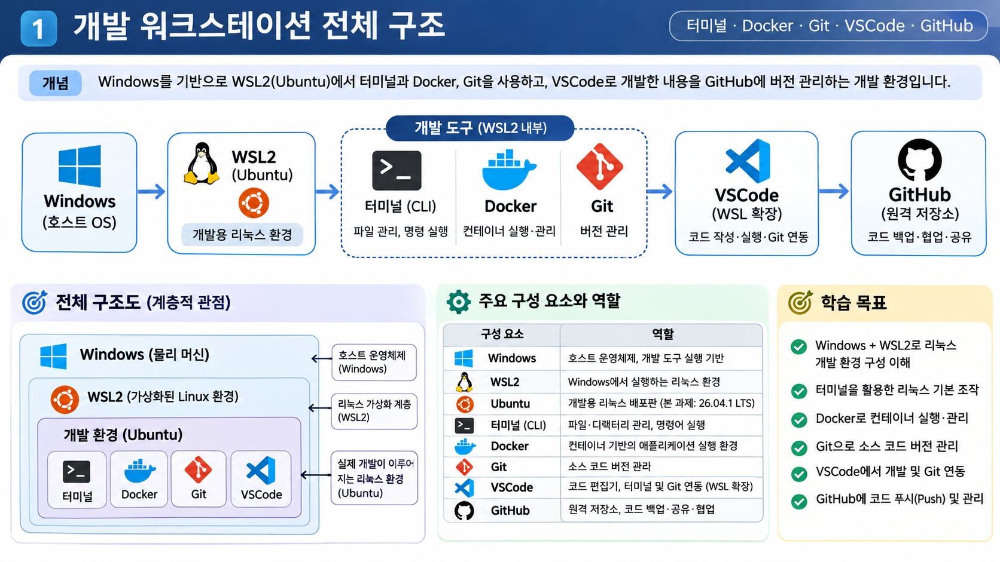

- **Windows**: 호스트 운영체제입니다.
- **WSL2**: Windows에서 Linux 환경을 실행할 수 있도록 합니다.
- **Ubuntu**: 실제 Linux 명령을 실행하는 배포판입니다.
- **CLI**: 파일·디렉터리 관리 및 명령 실행 도구입니다.
- **Docker**: 컨테이너 기반 실행 환경을 관리합니다.
- **Git**: 소스 코드의 변경 이력을 관리합니다.
- **VSCode**: WSL 환경의 프로젝트를 편집하고 실행합니다.
- **GitHub**: Git 저장소를 원격에 보관하고 공유합니다.

전체 흐름은 Windows → WSL2/Ubuntu → 개발 도구(CLI·Docker·Git·VSCode) → GitHub 원격 저장소입니다.

## 4. WSL2 및 Ubuntu

Windows에서 Linux 명령을 사용하기 위해 WSL2와 Ubuntu를 설치했습니다. 최초 설치 후 Ubuntu 배포판이 확인되지 않아 `wsl -l -v`로 상태를 확인하고 배포판을 별도로 설치했습니다.

PowerShell(관리자 권한)에서 실행:

```powershell
wsl --install -d Ubuntu
wsl -l -v
```

설치가 완료되면 Ubuntu를 실행하고 Linux 사용자 계정을 생성합니다.

## 5. Linux 파일 시스템과 CLI

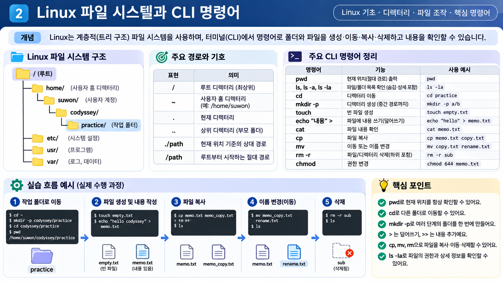

실습은 Windows 마운트 경로(`/mnt/c`)가 아니라 Linux 홈 디렉터리(`/home/suwon`) 아래에서 진행했습니다. Linux 파일 권한 실습을 정확하게 확인하기 위한 선택입니다.

| 명령어 | 기능 | 예시 |
|---|---|---|
| `pwd` | 현재 작업 경로 출력 | `pwd` |
| `ls -a` | 숨김 항목 포함 목록 | `ls -a` |
| `ls -la` | 상세 목록 및 권한 확인 | `ls -la` |
| `cd` | 디렉터리 이동 | `cd practice` |
| `mkdir -p` | 중간 경로를 포함한 디렉터리 생성 | `mkdir -p codyssey/practice` |
| `touch` | 빈 파일 생성 | `touch empty.txt` |
| `echo` | 문자열 출력 및 파일 기록 | `echo "hello" > memo.txt` |
| `cat` | 파일 내용 확인 | `cat memo.txt` |
| `cp` | 파일 복사 | `cp memo.txt memo_copy.txt` |
| `mv` | 파일 이동 또는 이름 변경 | `mv memo.txt renamed.txt` |
| `rm` | 파일 삭제 | `rm renamed.txt` |
| `rm -r` | 디렉터리와 내부 항목 삭제 | `rm -r sub` |

### 경로 기호

| 표현 | 의미 |
|---|---|
| `/` | 루트 디렉터리 |
| `~` | 현재 사용자의 홈 디렉터리 |
| `.` | 현재 디렉터리 |
| `..` | 상위 디렉터리 |
| `/home/suwon/...` | 절대 경로 |
| `./sub` | 현재 위치 기준 상대 경로 |

### 파일 기록의 차이

```bash
echo "첫 번째 내용" > memo.txt
echo "두 번째 내용" >> memo.txt
cat memo.txt
```

- `>`: 기존 파일 내용을 덮어씁니다.
- `>>`: 기존 내용 뒤에 새 내용을 추가합니다.

## 6. Linux 권한과 chmod

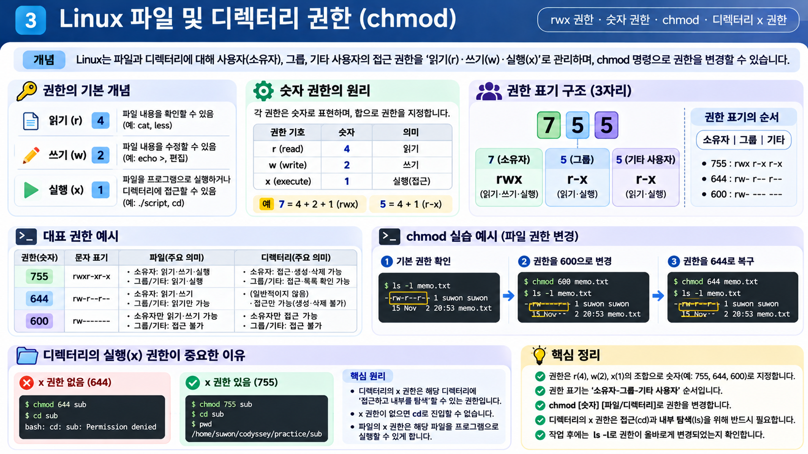

Linux 권한은 소유자(User), 그룹(Group), 기타 사용자(Other) 순서로 표시합니다.

| 권한 | 숫자 | 의미 |
|---|---:|---|
| `r` | 4 | 읽기 |
| `w` | 2 | 쓰기 |
| `x` | 1 | 실행 및 디렉터리 탐색 |

| 숫자 권한 | 문자 표기 | 의미 |
|---:|---|---|
| 755 | `rwxr-xr-x` | 소유자 읽기·쓰기·실행, 그룹·기타 읽기·실행 |
| 644 | `rw-r--r--` | 소유자 읽기·쓰기, 그룹·기타 읽기 |
| 600 | `rw-------` | 소유자만 읽기·쓰기 |

실습 명령:

```bash
ls -l memo.txt
chmod 600 memo.txt
ls -l memo.txt
chmod 644 memo.txt
ls -l memo.txt
```

디렉터리 권한 실습:

```bash
chmod 644 sub
cd sub
# Permission denied 발생 확인

chmod 755 sub
cd sub
pwd
```

파일의 `x`는 실행 권한이며, 디렉터리의 `x`는 해당 디렉터리에 접근하고 내부 항목을 탐색할 수 있는 권한입니다. 디렉터리에서 `x` 권한을 제거하면 일반적으로 해당 경로로 진입할 수 없습니다.

## 7. Docker 설치 및 기본 점검

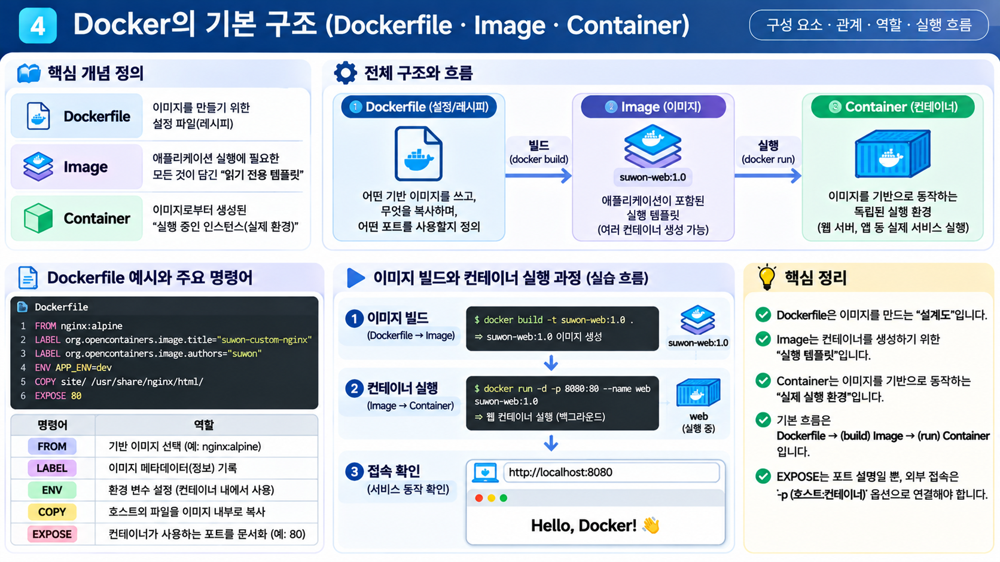

Docker Desktop을 설치한 뒤 WSL2 백엔드와 Ubuntu 통합을 활성화했습니다.

```bash
docker --version
docker info
docker images
docker ps
docker ps -a
```

- `docker --version`: Docker CLI 버전 확인
- `docker info`: Docker 클라이언트와 서버 정보 확인
- `docker images`: 로컬 이미지 목록 확인
- `docker ps`: 실행 중인 컨테이너 확인
- `docker ps -a`: 종료된 컨테이너를 포함한 전체 목록 확인

`docker info`에서 Server 정보가 출력되는 것을 확인하여 CLI와 Docker 데몬의 연결 상태를 점검했습니다.

### hello-world 실행

```bash
docker run hello-world
```

로컬에 이미지가 없으면 이미지를 내려받고 컨테이너를 실행합니다. `Hello from Docker!` 메시지가 출력되면 기본 실행이 정상적으로 이루어진 것입니다.

## 8. 컨테이너 실행과 생명주기

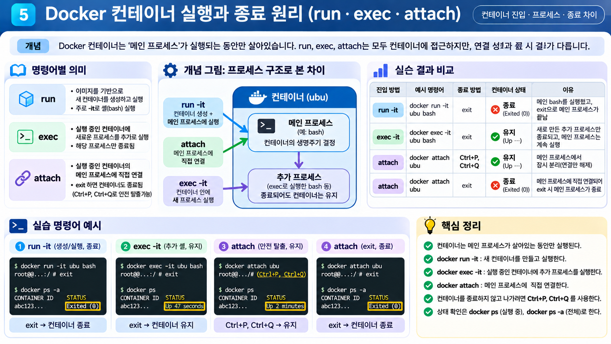

| 명령 | 역할 |
|---|---|
| `docker run -it` | 이미지로 새 컨테이너를 만들고 대화형으로 실행 |
| `docker exec -it` | 실행 중인 컨테이너 안에서 새 프로세스 실행 |
| `docker attach` | 실행 중인 컨테이너의 메인 프로세스에 연결 |

실습에서 확인한 종료 결과:

| 진입 방법 | 종료·분리 방법 | 컨테이너 상태 |
|---|---|---|
| `docker run -it` | `exit` | 종료 |
| `docker exec -it` | `exit` | 컨테이너 유지 |
| `docker attach` | `Ctrl+P`, `Ctrl+Q` | 컨테이너 유지, 연결만 해제 |
| `docker attach` | `exit` | 메인 프로세스 종료로 컨테이너 종료 |

컨테이너는 메인 프로세스가 실행 중인 동안 살아 있습니다. `exec`는 별도의 추가 프로세스를 실행하므로 그 셸에서 `exit`해도 메인 프로세스가 유지됩니다. `attach`는 메인 프로세스에 직접 연결하므로 `exit`하면 메인 프로세스가 종료될 수 있습니다.

상태 확인:

```bash
docker ps
docker ps -a
docker logs <컨테이너명>
```

## 9. Dockerfile과 커스텀 이미지

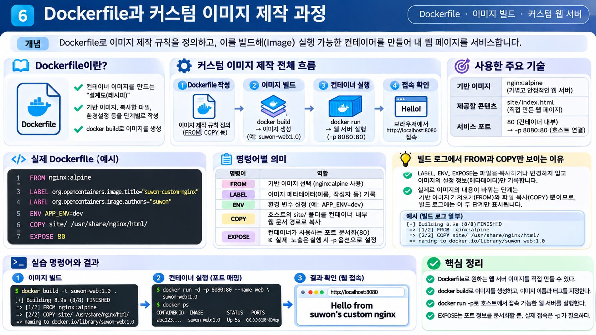

기존 `nginx:alpine` 이미지를 기반으로 직접 만든 정적 웹 페이지를 포함하는 커스텀 이미지를 제작했습니다.

### Dockerfile

```dockerfile
FROM nginx:alpine

LABEL org.opencontainers.image.title="suwon-custom-nginx"
LABEL org.opencontainers.image.authors="suwon"

ENV APP_ENV=dev

COPY site/ /usr/share/nginx/html/

EXPOSE 80
```

| 명령어 | 역할 |
|---|---|
| `FROM` | 기반 이미지 지정 |
| `LABEL` | 이미지 메타데이터 기록 |
| `ENV` | 환경 변수 설정 |
| `COPY` | 빌드 컨텍스트의 파일을 이미지 내부로 복사 |
| `EXPOSE` | 컨테이너가 사용할 포트를 문서화 |

`ENV APP_ENV=dev`는 환경 변수를 설정하지만 nginx의 기본 동작을 자동으로 변경하지는 않습니다. `EXPOSE 80` 역시 포트를 문서화하는 설정이며, 호스트에서 접속할 수 있도록 포트를 공개하려면 컨테이너 실행 시 `-p` 옵션을 사용해야 합니다.

### 이미지 빌드

```bash
docker build -t suwon-web:1.0 .
docker images
```

- `-t suwon-web:1.0`: 이미지 이름과 태그 지정
- `.`: 현재 디렉터리를 빌드 컨텍스트로 사용

## 10. 포트 매핑 및 웹 접속

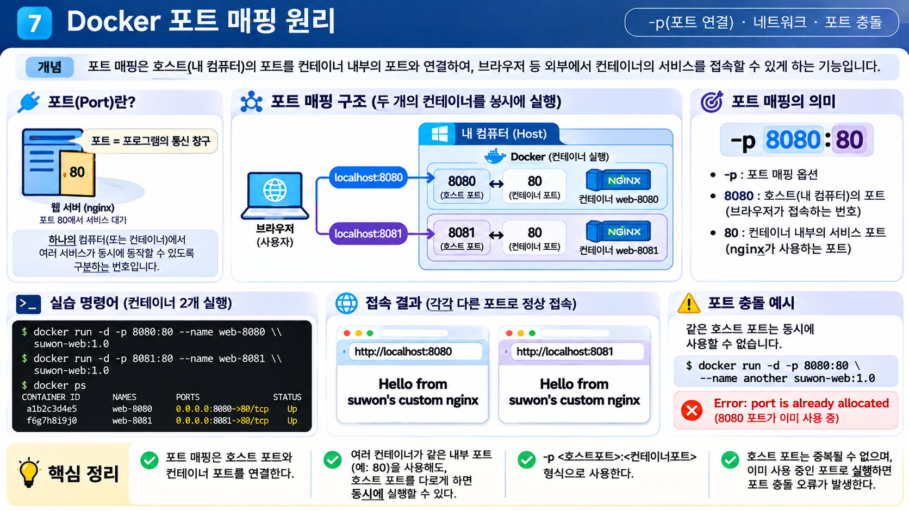

컨테이너 내부 웹 서버의 포트와 호스트 컴퓨터의 포트를 연결합니다.

```bash
docker run -d -p 8080:80 --name web-8080 suwon-web:1.0
docker run -d -p 8081:80 --name web-8081 suwon-web:1.0
docker ps
```

`-p 호스트포트:컨테이너포트` 형식입니다.

- `8080:80`: 호스트 8080 → 컨테이너 80
- `8081:80`: 호스트 8081 → 컨테이너 80

브라우저 접속 주소:

- http://localhost:8080
- http://localhost:8081

두 컨테이너는 내부에서 동일하게 80번 포트를 사용하지만 호스트 포트를 다르게 지정했으므로 동시에 실행할 수 있습니다.

### 포트 충돌 진단 및 해제 절차 — 평가 피드백 반영 추가

동일한 호스트 포트를 이미 다른 프로세스나 컨테이너가 사용 중이면 `port is already allocated` 또는 포트 바인딩 오류가 발생할 수 있습니다. 이때는 무작정 프로세스를 종료하지 말고, **누가 포트를 사용 중인지 확인한 뒤 소유한 서비스에 맞는 방법으로 해제**합니다.

#### 1) Docker 컨테이너가 포트를 사용하는지 확인

```bash
docker ps --filter "publish=8080"
docker ps -a
```

`docker ps` 결과에서 `PORTS` 항목이 `0.0.0.0:8080->80/tcp`처럼 표시되는 컨테이너가 해당 호스트 포트를 게시하고 있는지 확인합니다.

해당 컨테이너가 맞다면 컨테이너 이름 또는 ID를 확인한 후 정상적으로 중지합니다.

```bash
docker stop web-8080
```

필요한 경우 중지된 컨테이너를 삭제할 수 있습니다. 삭제는 컨테이너 자체를 제거하므로, 필요한 데이터가 볼륨에 저장되어 있는지 먼저 확인합니다.

```bash
docker rm web-8080
```

#### 2) Linux/WSL에서 포트를 점유한 프로세스 확인

```bash
sudo ss -ltnp 'sport = :8080'
```

`lsof`가 설치되어 있다면 다음 명령도 사용할 수 있습니다.

```bash
sudo lsof -nP -iTCP:8080 -sTCP:LISTEN
```

출력에 표시된 PID와 프로세스 이름을 확인합니다. `ss` 또는 `lsof` 결과가 비어 있다면 해당 Linux 환경에서 확인되는 리스닝 프로세스가 없다는 뜻일 수 있습니다. Docker Desktop을 사용하는 경우 Windows 호스트 측 포트 점유 여부도 확인합니다.

#### 3) Windows 호스트에서 포트 점유 프로세스 확인

PowerShell에서 실행합니다.

```powershell
netstat -ano | findstr :8080
```

마지막 열의 PID를 확인한 다음 프로세스 이름을 조회합니다.

```powershell
tasklist /FI "PID eq <PID>"
```

프로세스의 정체와 종료해도 되는 작업인지 확인한 후에만 종료합니다.

```powershell
taskkill /PID <PID> /T
```

강제 종료 옵션(`/F`)은 정상 종료가 되지 않고 해당 프로세스를 종료해도 된다는 점을 확인한 경우에만 사용합니다. 알 수 없는 시스템 프로세스나 다른 작업이 사용 중인 프로세스를 임의로 종료하지 않습니다.

#### 4) 포트 해제 확인 및 컨테이너 재실행

프로세스 또는 컨테이너를 정상적으로 중지한 뒤 다시 확인합니다.

```bash
sudo ss -ltnp 'sport = :8080'
docker ps --filter "publish=8080"
```

포트가 해제되었으면 기존 명령으로 다시 실행합니다.

```bash
docker run -d -p 8080:80 --name web-8080 suwon-web:1.0
docker ps
```

기존 호스트 포트를 비울 수 없거나 다른 서비스가 계속 사용해야 한다면, 사용 가능한 다른 호스트 포트를 선택합니다.

```bash
docker run -d -p 8081:80 --name web-8081 suwon-web:1.0
```

이 경우 브라우저에서는 `http://localhost:8081`로 접속합니다. 컨테이너 내부 포트 80은 그대로 유지하고 호스트 포트만 변경한 것입니다.

> **점검 순서:** `docker ps`로 컨테이너 확인 → `ss`/`lsof` 또는 Windows `netstat`으로 프로세스 확인 → 소유 서비스 정상 중지 → 포트 해제 재확인 → 컨테이너 재실행 및 브라우저 접속 검증.

## 11. 바인드 마운트

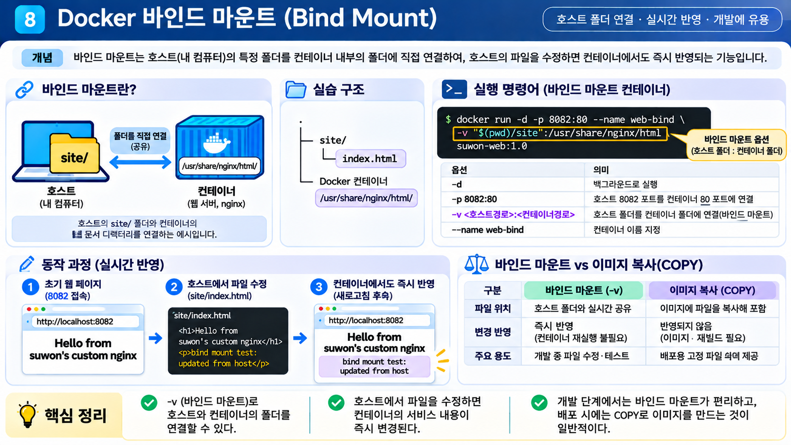

바인드 마운트는 호스트의 특정 폴더를 컨테이너 내부 경로에 직접 연결하는 방식입니다.

실습 명령:

```bash
docker run -d -p 8082:80 \
  --name web-bind \
  -v "$(pwd)/site":/usr/share/nginx/html \
  suwon-web:1.0
```

호스트에서 HTML 파일을 수정합니다.

```bash
echo "<p>bind mount test: updated from host</p>" >> site/index.html
```

`http://localhost:8082`를 새로고침하면 호스트에서 수정한 내용이 반영되는 것을 확인할 수 있습니다. 반면 이미지 빌드 시점에 `COPY`로 파일을 넣은 기존 컨테이너는 호스트 폴더와 연결되어 있지 않으므로 해당 수정이 자동 반영되지 않습니다.

| 구분 | 바인드 마운트 | 이미지의 COPY |
|---|---|---|
| 파일 위치 | 호스트 폴더와 컨테이너 경로 연결 | 빌드 시 이미지 내부에 복사 |
| 호스트 수정 반영 | 연결된 파일 변경이 컨테이너에 반영 | 이미지 재빌드 및 컨테이너 재생성 필요 |
| 주요 용도 | 개발 중 파일 수정 및 테스트 | 배포할 이미지에 파일 포함 |

## 12. Docker 볼륨과 데이터 영속성

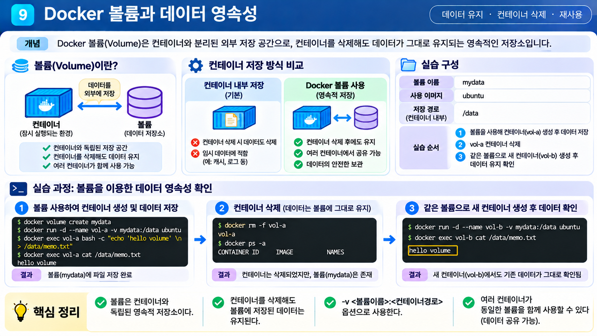

Docker 볼륨은 Docker가 관리하는 저장 공간으로, 컨테이너의 생명주기와 분리해 데이터를 보존할 수 있습니다.

실제 미션에서 사용한 볼륨 이름은 `suwon-data`입니다.

```bash
docker volume create suwon-data

docker run -d --name vol-a \
  -v suwon-data:/data \
  ubuntu sleep infinity
```

첫 번째 컨테이너에 데이터를 기록하고 확인합니다.

```bash
docker exec vol-a bash -c \
  "echo 'saved by vol-a' > /data/note.txt && cat /data/note.txt"
```

컨테이너를 삭제합니다.

```bash
docker rm -f vol-a
```

동일한 볼륨을 새 컨테이너에 연결합니다.

```bash
docker run -d --name vol-b \
  -v suwon-data:/data \
  ubuntu sleep infinity

docker exec vol-b cat /data/note.txt
```

기존에 저장한 `saved by vol-a`가 출력되는 것을 확인했습니다. 즉, 컨테이너 `vol-a`는 삭제되었지만 볼륨 `suwon-data`에 저장한 파일은 유지되었습니다.

볼륨 확인 명령:

```bash
docker volume ls
docker volume inspect suwon-data
```

| 구분 | 바인드 마운트 | Docker 볼륨 |
|---|---|---|
| 저장 위치 | 사용자가 지정한 호스트 경로 | Docker가 관리하는 저장 영역 |
| 주 용도 | 개발 중 파일 변경 반영 | 컨테이너와 독립적인 데이터 보존 |
| 컨테이너 삭제 | 호스트 원본 파일은 유지 | 볼륨을 삭제하지 않았다면 데이터 유지 |

## 13. Git 설정 및 GitHub 제출

Git은 로컬 프로젝트의 변경 이력을 관리하는 버전 관리 도구이며, GitHub는 Git 저장소를 원격에 보관하고 공유하는 서비스입니다.

### Git 기본 설정

```bash
git --version
git config --global user.name "suwon"
git config --global user.email "실제 사용하는 이메일 주소"
git config --global init.defaultBranch main
git config --list
```

`user.email`에는 예시 문구가 아니라 실제 사용할 이메일 주소를 입력합니다. 이메일 등 개인 정보는 공개 문서나 화면 캡처에 노출되지 않도록 주의합니다.

### 저장소 초기화 및 커밋

```bash
git init
git status
git add .
git status
git commit -m "프로젝트 초기 등록"
```

- `git add`: 커밋할 변경 사항을 스테이징 영역에 추가합니다.
- `git commit`: 스테이징된 변경 사항을 로컬 저장소의 이력으로 기록합니다.
- `git status`: 현재 작업 트리와 스테이징 상태를 확인합니다.

### 원격 저장소 연결 및 Push

```bash
git remote add origin https://github.com/leesw0224/codyssey-workstation.git
git push -u origin main
```

원격 저장소 확인:

```bash
git remote -v
git log --oneline
```

기존 수행 보고서에는 `b9af439` 이후 `d0c61aa` 커밋까지 두 차례 커밋한 것으로 기록되어 있습니다. GitHub 인증은 VSCode의 GitHub 로그인 흐름을 사용했으며 비밀번호나 토큰을 터미널에 직접 입력하지 않았습니다.

## 14. VSCode와 WSL 연동

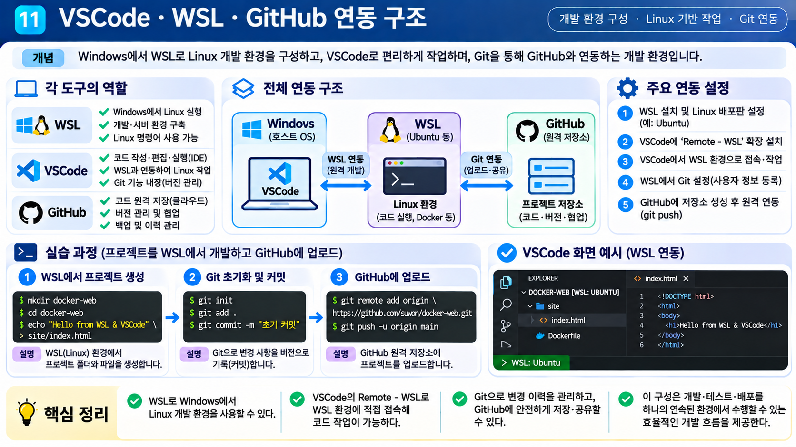

1. Windows에 Visual Studio Code 설치
2. Microsoft의 WSL 확장 설치
3. Ubuntu 터미널에서 프로젝트 디렉터리로 이동
4. `code .` 명령으로 현재 WSL 폴더를 VSCode에서 열기
5. Workspace Trust 설정
6. VSCode 통합 터미널에서 Git 명령 실행
7. GitHub 계정 인증 후 원격 저장소에 Push

```bash
cd ~/codyssey/workstation
code .
```

VSCode 하단 상태 표시줄에서 `WSL: Ubuntu` 연결 상태를 확인할 수 있습니다. 이 방식으로 Windows의 VSCode를 사용하면서 실제 파일과 명령 실행은 WSL의 Linux 개발 환경에서 진행할 수 있습니다.

## 15. 트러블슈팅

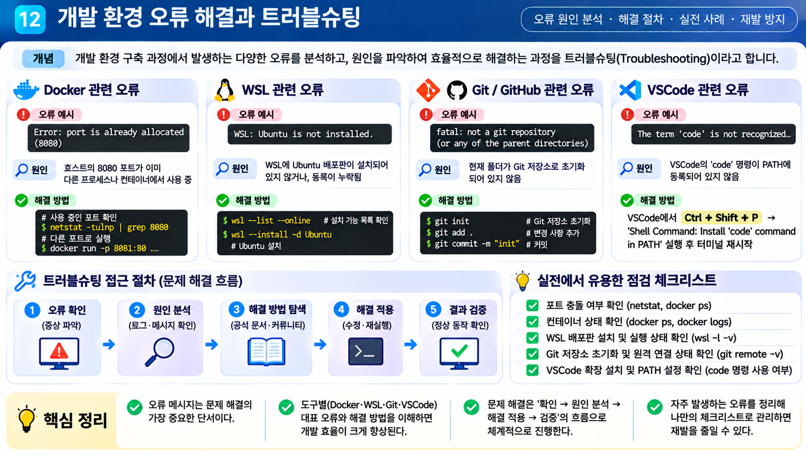

### 15-1. Ubuntu가 실행되지 않음

- **증상:** 시작 메뉴에서 Ubuntu가 검색되지 않음.
- **확인:** `wsl -l -v`에서 설치된 배포판이 없는 것을 확인.
- **해결:** 관리자 PowerShell에서 `wsl --install -d Ubuntu` 실행.

### 15-2. `mkdir` 실행 시 File exists

- **증상:** `mkdir: cannot create directory 'sub': File exists`
- **원인:** 동일한 이름의 디렉터리가 이미 존재.
- **확인:** `ls -la`
- **해결:** 기존 디렉터리를 사용하거나 중복 생성 오류를 피하려면 `mkdir -p sub` 사용.

### 15-3. Git 이메일 설정 오류

- **증상:** `git config --list`에서 `user.email`에 안내용 문구가 저장됨.
- **원인:** 예시의 자리 표시 문구를 실제 값 대신 입력.
- **해결:** 실제 이메일 주소로 다시 설정.

```bash
git config --global user.email "실제 사용하는 이메일 주소"
git config --global user.email
```

### 15-4. nginx 로그의 favicon.ico 404

- **증상:** `docker logs`에서 `/favicon.ico` 요청이 404로 기록됨.
- **확인:** 웹 페이지 요청(`/`)은 200이고 favicon 요청만 404인지 확인.
- **원인:** 브라우저가 탭 아이콘 파일을 요청했지만 해당 파일이 없음.
- **조치:** 페이지 본문 동작에는 영향이 없어 유지했습니다. 필요하면 `site/`에 favicon 파일을 추가할 수 있습니다.

### 15-5. README.md에 불필요한 실행 권한이 설정됨

- **증상:** README 파일 권한이 `-rwxr-xr-x`(755)로 표시됨.
- **원인:** 파일 복사 과정에서 실행 권한이 함께 설정됨.
- **해결:** 문서 파일에 적절한 권한인 644로 변경.

```bash
chmod 644 README.md
ls -l README.md
```

### 15-6. 이미지 복사 시 No such file or directory

- **증상:** `cp: cannot stat ... No such file or directory`
- **원인:** 지정한 경로에 원본 이미지가 없음.
- **확인:** 파일 탐색기에서 실제 다운로드 위치 확인.
- **해결:** 실제 파일이 있는 경로를 확인한 뒤 복사 명령을 다시 실행.

### 15-7. 포트 충돌 — 평가 피드백에 따라 보완

- **증상:** 컨테이너 실행 시 `port is already allocated` 등 포트 바인딩 오류 발생.
- **원인:** 동일한 호스트 포트를 다른 컨테이너 또는 프로세스가 사용 중.
- **진단 명령:**

```bash
docker ps --filter "publish=8080"
sudo ss -ltnp 'sport = :8080'
sudo lsof -nP -iTCP:8080 -sTCP:LISTEN
```

- **Windows 호스트 확인(PowerShell):**

```powershell
netstat -ano | findstr :8080
tasklist /FI "PID eq <PID>"
```

- **해제:** Docker 컨테이너가 점유 중이면 해당 컨테이너를 확인한 뒤 `docker stop <컨테이너명>`으로 중지합니다. 일반 프로세스라면 PID와 프로그램을 확인하고 종료해도 안전한 경우에만 정상 종료합니다.
- **재시작:** 포트가 해제되었는지 다시 확인한 뒤 컨테이너를 실행합니다. 기존 포트를 사용할 수 없다면 호스트 포트를 변경합니다.

```bash
docker run -d -p 8081:80 --name web-8081 suwon-web:1.0
```

이 15-7 항목은 평가에서 지적된 문서 누락을 보완하기 위해 추가한 진단·대응 절차입니다. 기존 수행 보고서에 실제 포트 충돌을 해결한 실행 로그가 있었다는 뜻은 아닙니다.

## 16. 과제 목표 정리

| 핵심 개념 | 정리 |
|---|---|
| 절대 경로와 상대 경로 | `/`로 시작하면 절대 경로이며, 그 외에는 현재 위치를 기준으로 하는 상대 경로입니다. |
| Linux 권한 | `r=4`, `w=2`, `x=1`을 소유자·그룹·기타 사용자 순서로 표시합니다. |
| Dockerfile과 이미지 | Dockerfile의 지시문으로 이미지 제작 규칙을 정의하고 `docker build`로 이미지를 생성합니다. |
| 이미지와 컨테이너 | 이미지는 실행 기반이며 컨테이너는 이미지로부터 생성되어 실제 실행되는 인스턴스입니다. |
| 포트 매핑 | `-p 호스트포트:컨테이너포트`로 호스트에서 컨테이너 서비스에 접근하도록 연결합니다. |
| 바인드 마운트 | 호스트 폴더와 컨테이너 경로를 직접 연결해 파일 변경을 공유합니다. |
| Docker 볼륨 | 컨테이너와 독립적으로 데이터를 보존할 수 있는 Docker 관리 저장 공간입니다. |
| Git과 GitHub | Git은 버전 관리 도구이고 GitHub는 Git 저장소를 원격으로 보관·공유하는 서비스입니다. |

## 17. 최종 결과물 및 저장소 구조

- GitHub 저장소: https://github.com/leesw0224/codyssey-workstation
- 커스텀 이미지: `suwon-web:1.0`
- Docker 볼륨: `suwon-data`
- 최종 확인 커밋: `d0c61aa`
- 개념 설명용 인포그래픽: 12장

```text
codyssey-workstation/
├── README.md
├── Dockerfile
├── site/
│   └── index.html
└── docs/
    └── images/
        ├── (기존 수행 증거 이미지 5장 유지)
        └── concepts/
            ├── 01-workstation-overview.png
            ├── 02-linux-filesystem-cli.png
            ├── 03-linux-permissions-chmod.png
            ├── 04-docker-basics.png
            ├── 05-docker-run-exec-attach.png
            ├── 06-dockerfile-custom-image.png
            ├── 07-docker-port-mapping.png
            ├── 08-docker-bind-mount.png
            ├── 09-docker-volume-persistence.png
            ├── 10-git-github-workflow.png
            ├── 11-vscode-wsl-github.png
            └── 12-troubleshooting.png
```

## 18. 개념 설명 이미지 12장

아래 이미지는 각 개념의 학습을 돕기 위한 보조 자료입니다. 정확한 수행 명령과 결과는 각 장의 본문을 기준으로 확인합니다.

### 01. 개발 워크스테이션 전체 구조


### 02. Linux 파일 시스템과 CLI


### 03. Linux 파일 및 디렉터리 권한


### 04. Docker 기본 구조


### 05. Docker run · exec · attach


### 06. Dockerfile과 커스텀 이미지


### 07. Docker 포트 매핑


### 08. Docker 바인드 마운트


### 09. Docker 볼륨과 데이터 영속성


### 10. Git과 GitHub 버전 관리
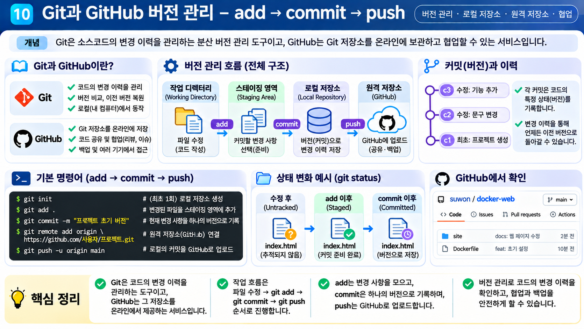

### 11. VSCode · WSL · GitHub 연동


### 12. 개발 환경 오류 해결과 트러블슈팅


---

**작성 원칙:** 실제 수행 결과와 평가 피드백에 따른 문서 보완 내용을 구분했습니다. 이미지의 설명 문구가 실제 수행 로그와 다를 경우, 명령어와 실행 결과가 기록된 본문을 기준으로 합니다.
